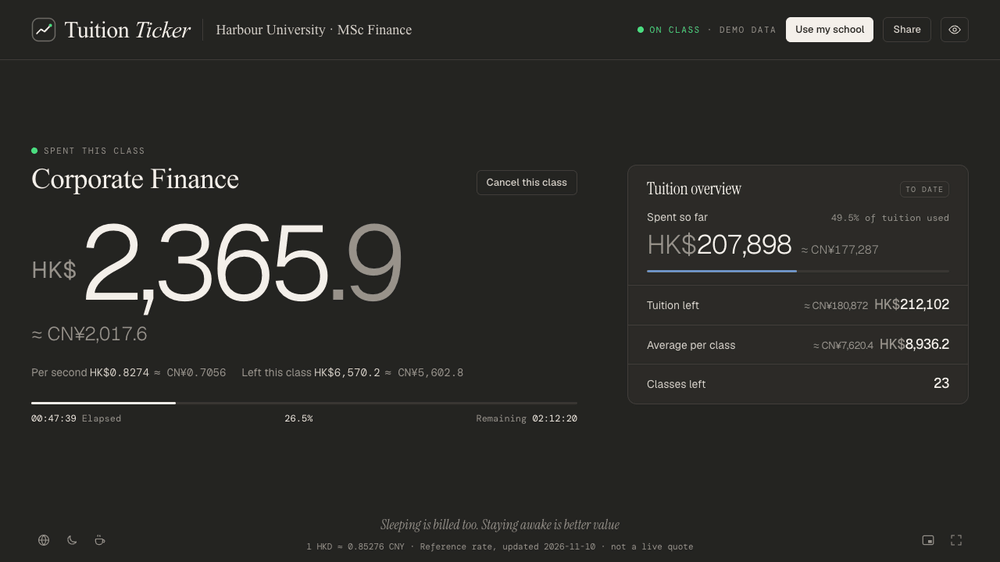
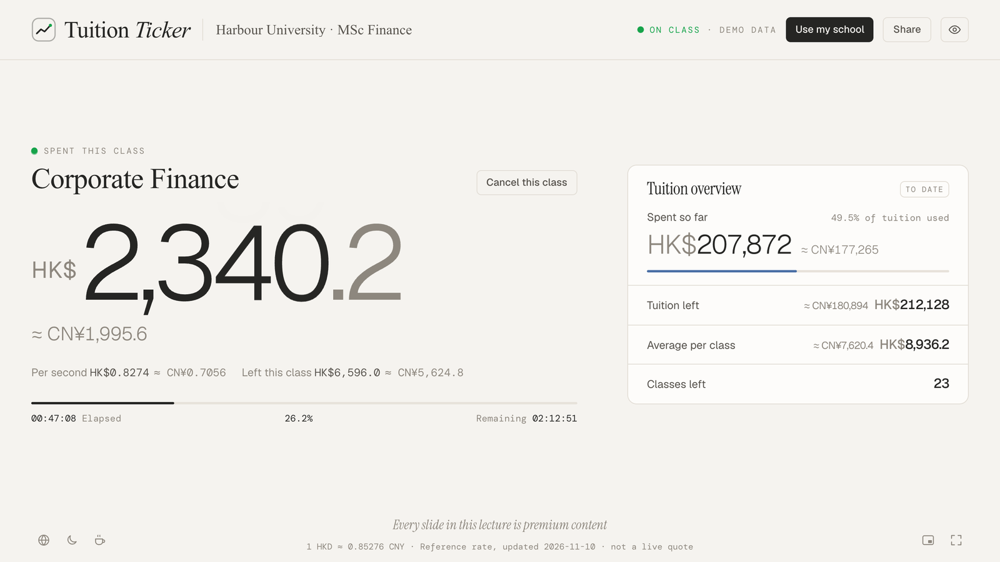
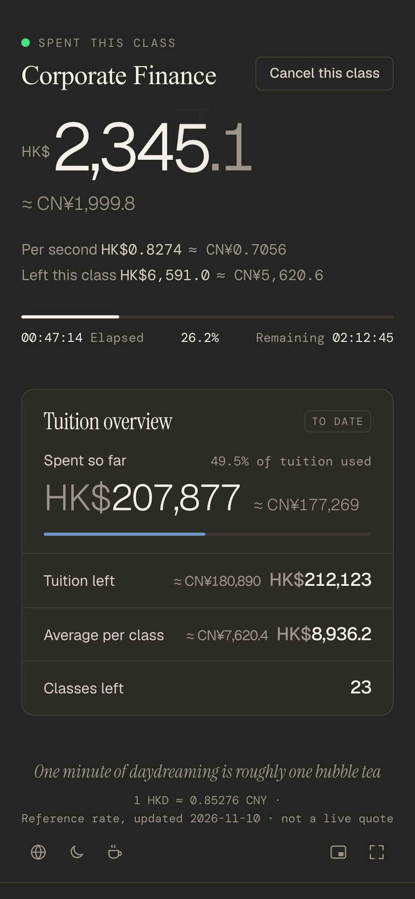
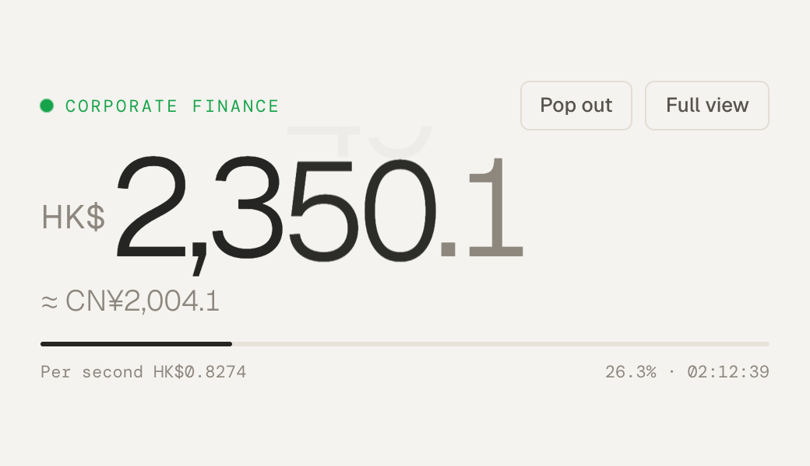

<div align="center">

# Tuition Ticker

**Watch your tuition tick away, second by second.**

[Open the app](https://edricd-ops.github.io/tuition-ticker/) · [中文](README.md) · [Contributing](CONTRIBUTING.md)



</div>

Open the page in class, pick the course you're sitting in, and Tuition Ticker works out from your tuition and timetable how much this class has cost so far — live, to the second, and converted into a currency you think in. Leave it full screen, or shrink it to an always-on-top window in the corner.

No sign-up and no install: **first-time visitors see a live demo straight away**, and your settings never leave your browser.

## Features

- **Live to the second**: spent so far, cost per second, what's left of this class, progress; open it halfway through and the numbers are already right
- **Fully customisable**: tuition, first day of term, each course's weekdays, times and number of weeks; search 463 schools (the QS 2027 top 500 outside mainland China) by English, local or Chinese name or abbreviation, or type any name
- **Timetable import**: `.ics` calendar files, a CSV template (save as CSV from Excel), or pasted text
- **Currency conversion**: `≈` amounts next to every figure, daily reference rates or a fixed rate of your own
- **Holidays**: Hong Kong and Macau public holidays for 2026–2027 built in, plus your own school breaks such as reading week; classes on holidays aren't billed
- **Mini view and pop-out**: `?view=mini` shows only the key numbers; Chrome and Edge can pop it out into an always-on-top window
- **Made for sharing**: export a 3:4 or 9:16 share card in one click, with an option to hide amounts; three privacy levels mask figures for photos in class
- **Share links**: the whole config fits in a link, so classmates can load the same timetable and save it
- **Works offline**: installable as a PWA and opens without a connection
- Chinese / English, light / dark, following your system or set by hand

## Screenshots



<table>
  <tr>
    <td width="36%"></td>
    <td valign="top"><br><br>Mini view keeps just the running total, conversion and progress; in Chrome or Edge it pops out into an always-on-top window.<br><br>On the left: the dashboard on a phone.</td>
  </tr>
</table>

## Get started

1. Open the site and click **Use my school** in the top right
2. Enter your school, tuition and first day of term, then add courses (or import a timetable)
3. In class, open the page and tap the course you're in

## How it's calculated

- **Cost per second = total tuition ÷ total seconds of class in the term**, one rate for every course
- Each course meets on its weekdays for its number of weeks, counted from the first day of term; overlapping classes are counted once
- Classes on school holidays, and on public holidays you haven't muted, don't count; their share is spread over the remaining classes
- Times are read in **the school's time zone**, so travelling or flying home doesn't change anything, and daylight saving time is handled
- "Spent so far this term" follows the timetable; you don't have to open the app for every class

## Privacy

- Your school, tuition and timetable are **stored only in this browser's localStorage** and never uploaded
- Share links keep the config after `#`, which browsers don't send to servers
- The site counts anonymous visits with [GoatCounter](https://www.goatcounter.com/): no cookies, no personal identification and no config data
- Exchange rates come from [open.er-api.com](https://open.er-api.com/) (fallback: [Frankfurter](https://frankfurter.dev/)); only the rates are requested

## Development

Requires Node.js 22 or newer.

```bash
npm install
npm run dev      # http://localhost:5173
npm test         # unit tests, run once in each of three time zones
npm run build    # production build into dist/
```

Built with Vite, React, TypeScript and Tailwind CSS. The billing logic is a separate pure-function module (`src/core/`) with full unit tests. Pushes to `main` deploy to GitHub Pages through GitHub Actions.

## Contributing

Data contributions are the most welcome:

- **Schools**: `presets/schools.json` — fix names, add abbreviations or schools
- **Public holidays**: `presets/holidays/{region}.json` — official sources only
- **Quips**: `src/data/quips.json` — self-deprecating and light, never fear-mongering

See [CONTRIBUTING.md](CONTRIBUTING.md) for formats and workflow.

## Support the project

If it made you pay a little more attention in class, you can buy me a coffee. It keeps the project free and ad-free:

- [Buy Me a Coffee](https://buymeacoffee.com/edric): card
- [Afdian](https://afdian.com/a/edric0108): WeChat Pay / Alipay

The coffee icon at the bottom left of the site opens it too.

### Sponsors

Thank you to the "attentive student" sponsors (the ¥50 tier). Those who'd like to be named are listed here:

<!-- Add in order, one per line: - Name (optional link) -->

*Your name could be here.*

## Acknowledgements

- Inspired by **港硕上课鼓励器** ("HK master's class motivator", HKU edition) on Xiaohongshu. This project is written from scratch and uses none of its code.
- The school list comes from public QS World University Rankings 2027 data and is used only for search suggestions. It does not imply any school's affiliation with or endorsement of this project.
- Public holidays come from open data published by the Hong Kong SAR Government (1823) and the Macao SAR Government.
- Fonts: [Geist](https://vercel.com/font), [Instrument Serif](https://fonts.google.com/specimen/Instrument+Serif), [DM Mono](https://fonts.google.com/specimen/DM+Mono), [Tinos](https://fonts.google.com/specimen/Tinos).

## Disclaimer

Amounts are estimates from the tuition and timetable you enter, for fun and motivation only. Exchange rates are reference rates, not live quotes.

## License

[MIT](LICENSE) © Edric D.
