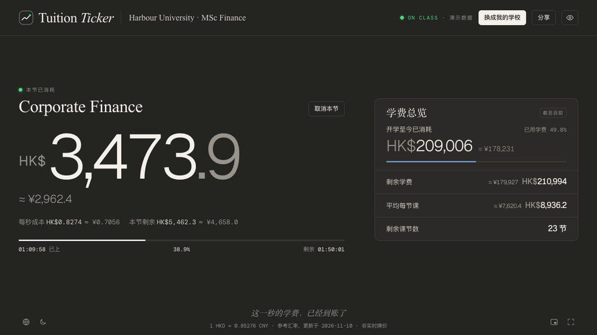
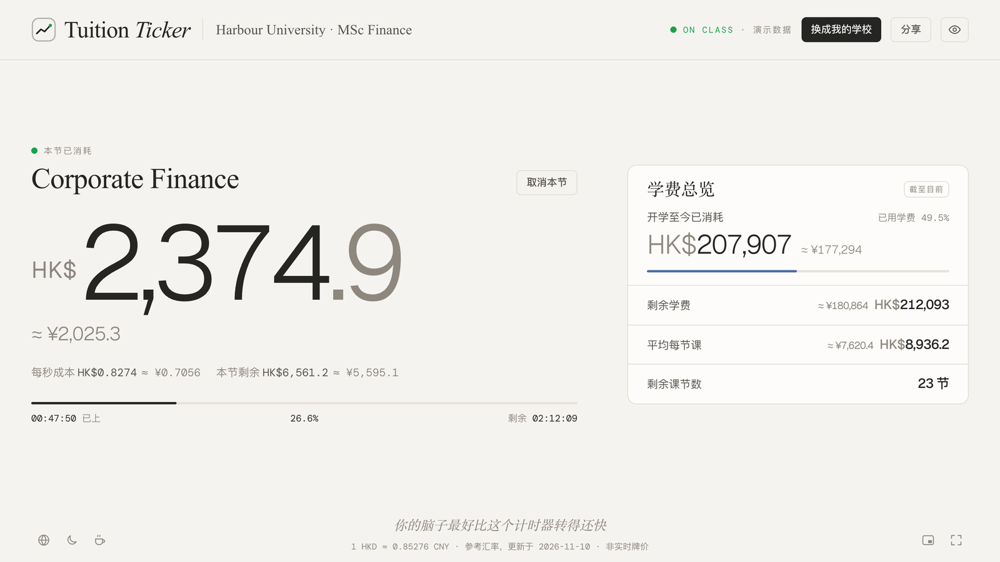
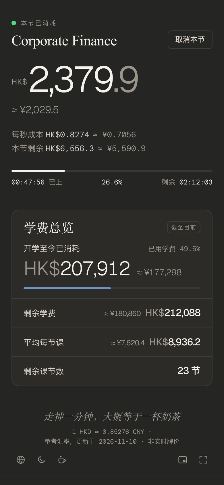
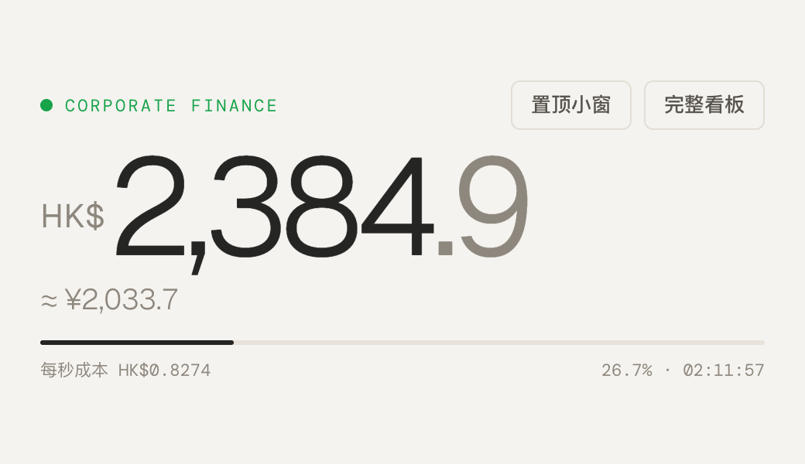

<div align="center">

# Tuition Ticker · 上课学费计时器

**这节课，你的学费正在按秒燃烧。**

[立即打开](https://edricd-ops.github.io/tuition-ticker/) · [English](README.en.md) · [参与贡献](CONTRIBUTING.md)



</div>

上课时打开网页，选中正在上的课，Tuition Ticker 会根据你的学费和课表，实时显示「这节课已经烧掉多少钱」，还能换算成人民币等你熟悉的货币。可以全屏开着，也可以缩成置顶小窗挂在屏幕角落。

不用注册、不用安装，**打开就能先看演示**；所有配置只保存在你自己的浏览器里。

## 功能

- **按秒跳动**：本节已消耗、每秒成本、本节剩余、进度条；中途打开也直接显示正确金额
- **完全可自定义**：学费、开学日期、每门课的上课日和时间、上几周；463 所学校可检索（QS 2027 前 500 名中的非内地高校），中文、英文、缩写都能搜，不在列表里的也能直接填
- **导入课程表**：`.ics` 日历文件、CSV 模板（Excel 另存为即可），或者直接粘贴文本
- **多币种换算**：所有金额旁显示 `≈ ¥…`，参考汇率每日更新，也可以手动固定汇率
- **假日**：内置香港、澳门 2026–2027 年公众假期，可添加阅读周等学校假日；假日的课不计费
- **迷你模式与置顶小窗**：`?view=mini` 只显示核心数字；Chrome / Edge 可以弹出始终置顶的小窗
- **适合分享**：一键导出 3:4（小红书）或 9:16（Story）分享卡片，可隐藏具体金额；三档隐私打码，方便在教室拍照
- **分享链接**：把整份配置压缩进链接，同学打开后确认保存，就能用同一份课表
- **离线可用**：可以安装到桌面（PWA），断网也能打开
- 中文 / English，浅色 / 深色，跟随系统或手动切换

## 截图



<table>
  <tr>
    <td width="36%"></td>
    <td valign="top"><br><br>迷你模式：只留本节已消耗、换算和进度；在 Chrome / Edge 里可以弹成始终置顶的小窗。<br><br>左边是手机竖屏的样子。</td>
  </tr>
</table>

## 三步用起来

1. 打开网站，点右上角「**换成我的学校**」
2. 填总学费、一共上几节课、每节多长，十秒就能看到「一节课多少钱」（想更精确，可以改用课表设置：开学日期 + 每门课的上课日和时间，或导入课程表）
3. 上课时打开页面，点「开始计费」（课表模式下点正在上的课），开始跳数

## 怎么算的

- **每秒成本 = 总学费 ÷ 整个学期的上课总秒数**，所有课程用同一个费率
- 快速设置下，上课总秒数 = 总节数 × 每节时长；以下几条是课表模式的规则
- 每门课从开学日期算起，在指定的上课日上课，一共上指定的周数；时间重叠的课只算一次
- 学校假日、以及没被关掉提醒的公众假期，当天的课不算，学费分摊到其余课节上
- 上课时间按**学校所在时区**计算，回国或出差时电脑时区变了也不影响，夏令时会自动处理
- 「开学至今已消耗」按课表推算，不需要每节课都打开

## 隐私

- 你的学校、学费、课表**只存在这个浏览器的 localStorage 里**，不会上传到任何服务器
- 分享链接把配置放在网址 `#` 后面，这部分不会发送给服务器
- 网站用 [GoatCounter](https://www.goatcounter.com/) 统计匿名访问量：不用 cookie，不识别个人，也不包含任何配置内容
- 汇率从 [open.er-api.com](https://open.er-api.com/)（备用 [Frankfurter](https://frankfurter.dev/)）获取，只请求汇率，不发送你的数据

## 本地开发

需要 Node.js 22 或以上。

```bash
npm install
npm run dev      # http://localhost:5173
npm test         # 单元测试，会在三个时区下各跑一遍
npm run build    # 生产构建，输出到 dist/
```

技术栈：Vite + React + TypeScript + Tailwind CSS。计费逻辑是独立的纯函数模块（`src/core/`），有完整的单元测试。推送到 `main` 后由 GitHub Actions 自动部署到 GitHub Pages。

## 参与贡献

最欢迎补充数据：

- **学校**：`presets/schools.json`，修正译名、补缩写、加学校
- **公众假期**：`presets/holidays/{地区}.json`，必须附官方来源
- **吐槽文案**：`src/data/quips.json`，自嘲、轻松，不贩卖焦虑

格式和流程见 [CONTRIBUTING.md](CONTRIBUTING.md)。

## 支持这个项目

如果它让你上课多认真了一点，欢迎请我喝杯咖啡，帮它继续免费、无广告地更新：

- [爱发电](https://afdian.com/a/edric0108)：微信 / 支付宝
- [Buy Me a Coffee](https://buymeacoffee.com/edric)：银行卡

网站页脚左下角的咖啡图标也能直接打开。

### 赞助者

感谢「认真听讲赞助人」（¥50 档）。愿意署名的赞助者会列在这里：

<!-- 按时间顺序添加，格式：- 名字（可附链接） -->

*虚位以待*

## 致谢

- 灵感来自小红书上的「**港硕上课鼓励器**」（HKU 版）。本项目从零实现，没有使用它的代码。
- 学校候选名单来自 QS 世界大学排名 2027 的公开数据，只用于输入时检索，不代表任何学校与本项目有关联或认可本项目。
- 公众假期来自香港特区政府（1823）和澳门特区政府的公开数据。
- 字体：[Geist](https://vercel.com/font)、[Instrument Serif](https://fonts.google.com/specimen/Instrument+Serif)、[DM Mono](https://fonts.google.com/specimen/DM+Mono)、[Tinos](https://fonts.google.com/specimen/Tinos)。

## 免责声明

金额按你填写的学费和课表推算，仅供娱乐和自我激励；汇率为参考汇率，不是实时交易牌价。

## 许可证

[MIT](LICENSE) © Edric D.
